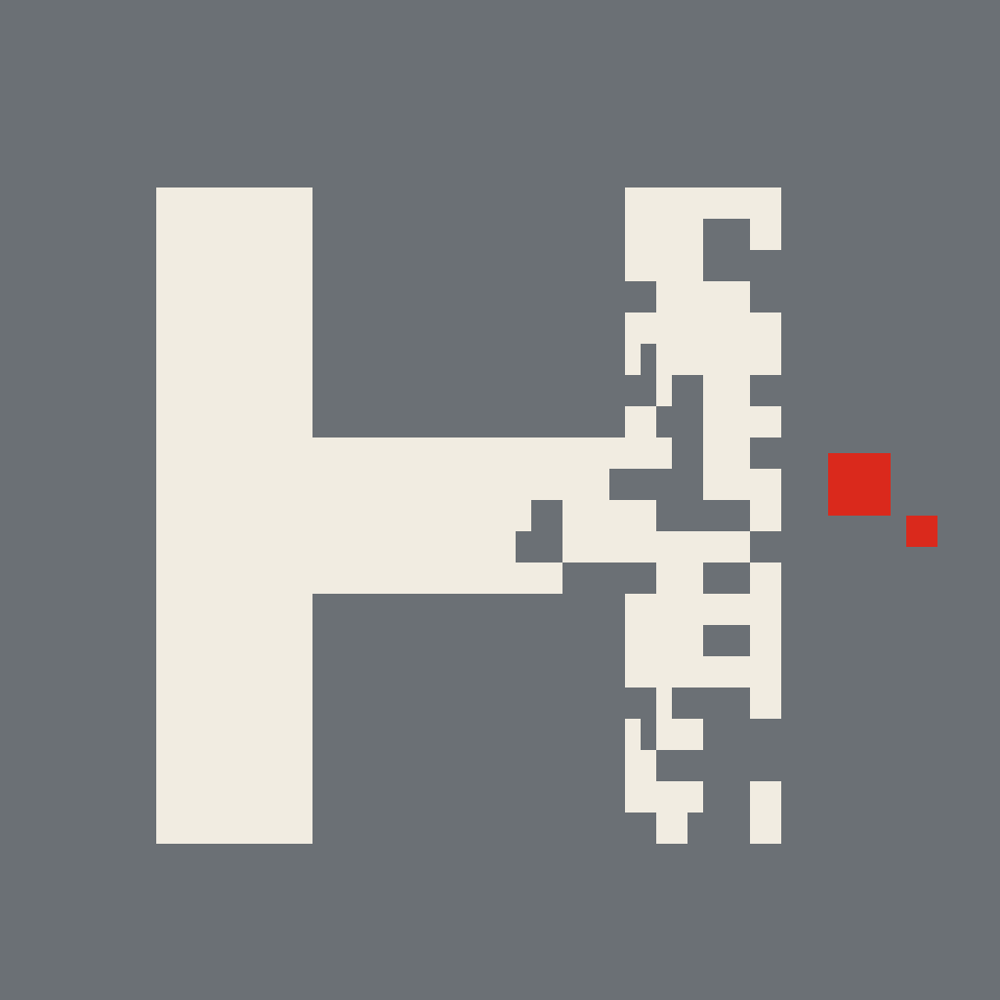

# H · 像素头像

围绕字母 **H** 设计的像素风头像——科技感、极客风，在深色与浅色界面切换时都能自然融入。

## 主题故事

H 的右半边像素化正在剥离，红色颗粒是消散的前沿——像数据上传途中截取的一帧。画面不是一个状态，而是一个过程：左半静止永恒，右半正在离开。

风格血统：**故障艺术（Glitch Art）/ 数据主义**，与蒸汽波、复古计算美学共用词汇。核心手法半调抖动（dither）是低色深时代的显示宿命，如今被回收成审美。严格瑞士国际主义追求静止、永恒、中性，这一系恰恰贩卖不完整的瞬间——偏后现代、解构，站在瑞士风格的对立面。

## 文件清单

| 文件 | 说明 |
|---|---|
| `T3seed21_final_1024.png` | 头像定稿，1024×1024，中灰底——头像场景一律用这个 |
| `design.md` | 完整设计规范：色值、网格参数、seed、工艺与延展规则 |

## 核心参数速览

- **母版**：64×64 px，nearest 硬边放大导出 512/1024，无抗锯齿
- **字形**：双柱 10px ／ 间隙 20px ／ 总宽 40px ／ 高 42px，左对齐（x=10, y=12）
- **消散**：右半按 x 加权剥离，碎块 3×2，封顶 0.72，幂 2.2，**随机种子 21**（换种子 = 换侵蚀形态，同族不同脸）
- **裁圆安全**：圆形裁切半径 32，全部元素验算零越界

## 配色：为深浅主题切换而生

| 角色 | 色值 | 说明 |
|---|---|---|
| 背景 中灰 | `#6B7075` | 明度中档、低饱和——深底上不刺眼，浅底上不发黑 |
| 主形 米白 | `#F1ECE1` | 对中灰底约 4.2:1，清晰但不挑衅，两种主题下观感一致 |
| 强调 红 | `#DA291C` | 只用于消散前沿颗粒，极小面积，任何主题下都是第一眼落点 |

策略不是"双向高对比"，而是**中等明度低饱和底 + 近黑/米白主形 + 极小面积强调色**。透明底版本仅用于深色或高对比背景（米白贴浅底会隐身）。

## 许可

[MIT](LICENSE)
